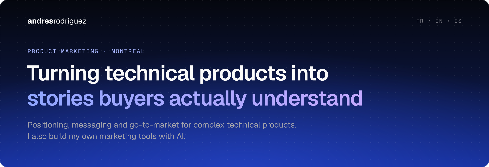
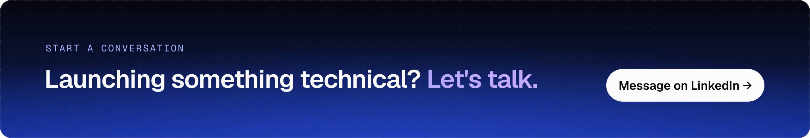

## The point of view

> Technical products don't sell on specs. They sell when a buyer can explain it to their boss in one sentence.

Hi, I'm Andres. A lot of what's on this profile started as a workaround. I didn't want to wait on an agency for a launch video, so I made one with Claude Code and an ElevenLabs voiceover. I needed a portfolio, so I built one in React and put it on Vercel. The repos below came from the same habit.

📍 Montreal, QC &nbsp;·&nbsp; 🗣️ French, English, Spanish &nbsp;·&nbsp; 🌐 [andresrdz.vercel.app](https://andresrdz.vercel.app/)

## Products and proof

| | What it does |
|---|---|
| [**pmm-launch-kit**](https://github.com/iamandresrodri/pmm-launch-kit) | You give Claude your product notes. It writes the positioning first, checks it with you, then builds the messaging, launch brief, battlecard and FAQ from that, so all five docs say the same thing. |
| [**quebec-french-copy**](https://github.com/iamandresrodri/quebec-french-copy) | Marketing copy in Quebec French. Courriel, not e-mail. Tu or vous, picked once and kept. AI tends to hand Quebec readers Paris French, and people here notice. |
| [**andresrdz.vercel.app**](https://andresrdz.vercel.app/) | My portfolio. Built with Claude Code, in English and French. |

Both skills are free. If one gets something wrong, open an issue. I'd like to know.

## What I've worked on

- Deep tech, mostly: HPC and AI infrastructure, wireless chips, some B2B SaaS
- At SPARK Microsystems, I helped get our wireless chip adopted by gaming brands
- Lately, go-to-market for an HPC/AI infrastructure startup that's still in stealth, so that's all I can say about it

## Start a conversation

