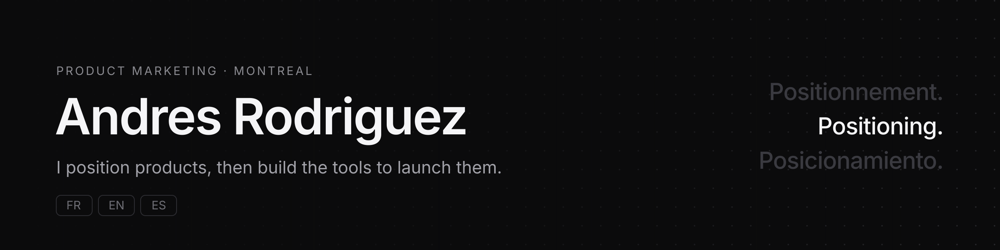

Hi, I'm Andres. I'm a product marketer in Montreal. I work in French, English or Spanish, depending on who's on the other end.

A lot of what's on this profile started as a workaround. I didn't want to wait on an agency for a launch video, so I made one with Claude Code and an ElevenLabs voiceover. I needed a portfolio, so I built [andresrdz.vercel.app](https://andresrdz.vercel.app/) in React and put it on Vercel. The two repos below came from the same habit.

**What I've worked on**
- Deep tech, mostly: HPC and AI infrastructure, wireless chips, some B2B SaaS
- At SPARK Microsystems, I helped get our wireless chip adopted by gaming brands
- Lately, go-to-market for an HPC/AI infrastructure startup that's still in stealth, so that's all I can say about it

**Repos**
- [pmm-launch-kit](https://github.com/iamandresrodri/pmm-launch-kit): you give Claude your product notes, it writes the positioning first and checks it with you, then builds the messaging, launch brief, battlecard and FAQ from that. The point is that all five docs end up saying the same thing.
- [quebec-french-copy](https://github.com/iamandresrodri/quebec-french-copy): marketing copy in Quebec French. Courriel, not e-mail. Tu or vous, picked once and kept. AI tends to hand Quebec readers Paris French, and people here notice.

Both are free. If one gets something wrong, open an issue. I'd like to know.

[LinkedIn](https://www.linkedin.com/in/andresrodrigz/) · [Portfolio](https://andresrdz.vercel.app/)
